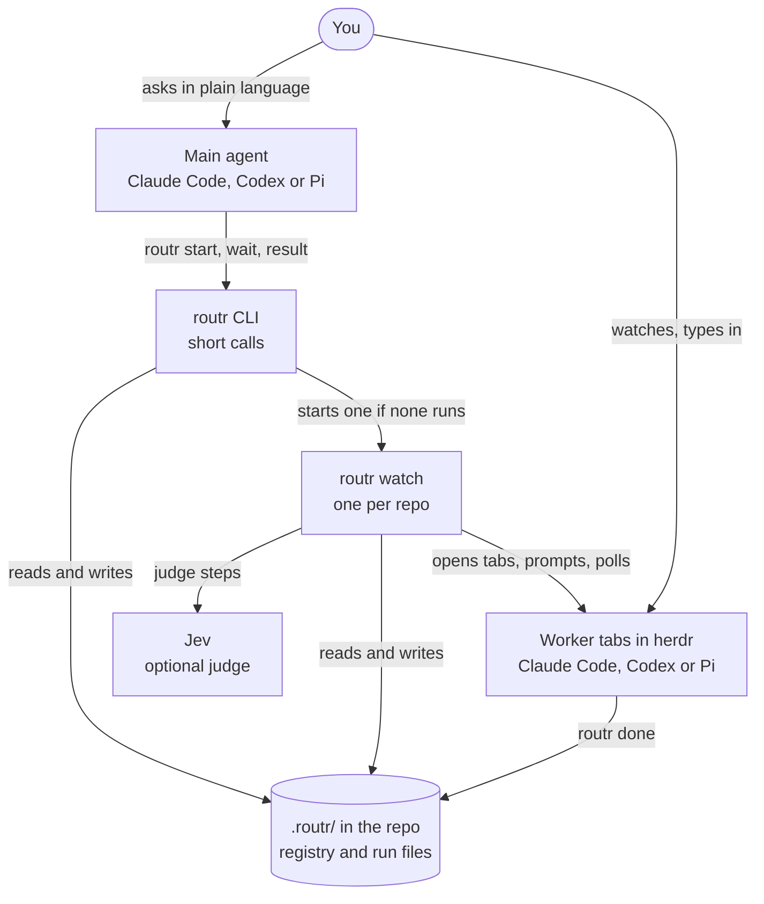
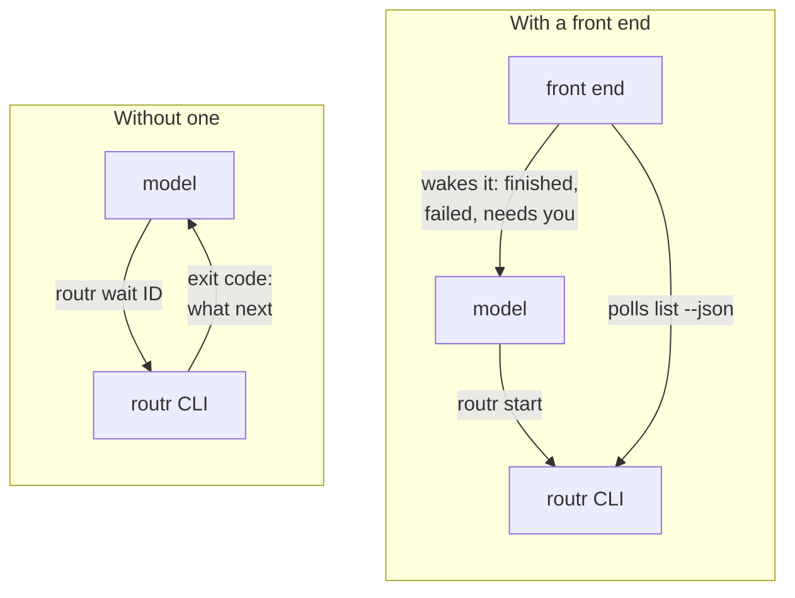
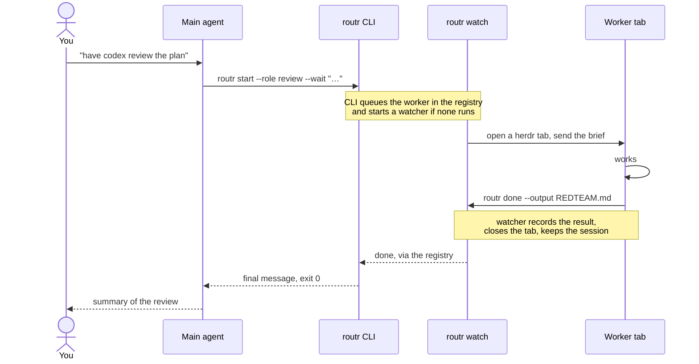
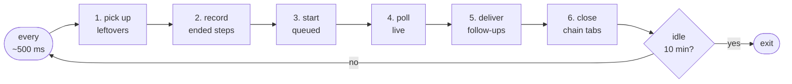
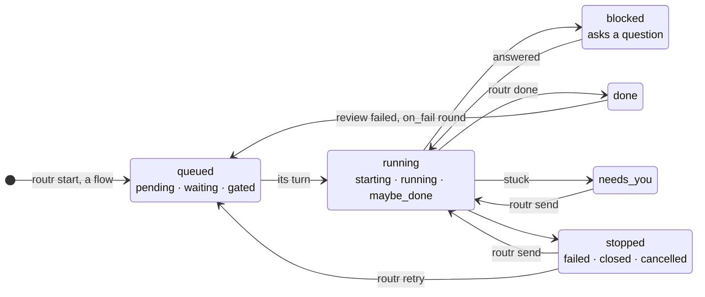
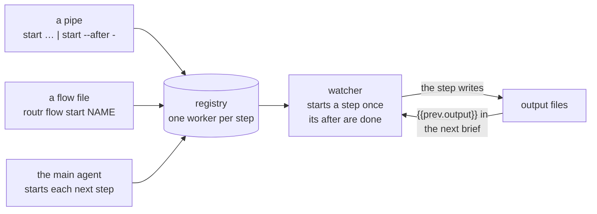
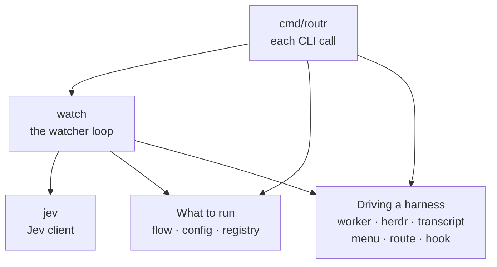

# Architecture: what talks to what

This is the map, and why routr is shaped this way. What an agent using
routr needs ships with the skill: the CLI in
[cli.md](../skills/routr/cli.md), flow files in
[flows.md](../skills/routr/flows.md). The built-in flows are drawn in
[default-flows.md](default-flows.md). Which doc says what: section 10.

The diagrams are maps, not specs: each answers one question, and the text
under it has the detail.

## Design choices

- **Pure CLI plus skills.** routr is a command-line tool that any agent
  calls from its shell. Each call is short: it reads or writes the
  registry and returns. One skill (`skills/routr/SKILL.md`) says when and
  how to use it, and Claude Code, Codex and Pi all read that format; the
  slash commands are thin fallbacks that point at the skill. You ask in
  plain language ("have codex red-team the plan"), and the main agent
  writes the brief, because it knows what "the plan" is. Nothing in the
  core path is an MCP server, an extension tool or a hook, so any harness
  with a shell can use routr and none needs routr installed into it. The
  one hook routr sets, Claude's PermissionRequest, decides nothing: it
  only records what a prompt is about. Output is written for agents: the
  result on stdout, exit codes that say what to do next, `--json` for
  structure.
- **A watcher per repo.** A shell tool call has a time limit (Claude's
  caps at 10 minutes), so no CLI call may hold a worker or a chain open.
  Something still has to drive workers between calls: `routr watch`, one
  per repo, keyed by the git common dir, so a repo's worktrees share it
  and two repos never do. Any command that needs it starts it, and it
  exits when idle. It keeps no state of its own: the registry is the
  state, so a watcher can die at any time and the next one picks up. A
  chain is queued work in the registry, not a process, so a tool timeout
  can't kill it.
- **Workers are herdr tabs.** Each worker is a real, interactive harness
  session (Claude Code, Codex or Pi) in its own herdr tab, with its own
  login, permission mode and transcript. You can watch it (`routr show`),
  type in it and answer its questions there; routr reimplements none of
  the harness. A tab is open while its worker has work: it closes once
  the worker has run `routr done`, and the session is kept, so `routr
  send` resumes it in a new tab, which closes again once the worker has
  answered. A worker still at work (`maybe_done`, `--interactive`) keeps
  its tab.
- **Front ends over one CLI.** Pi's extension (`pi/`) and the Claude Code
  plugin (`frontend/`) show workers live and wake the model when its
  workers finish or need you. They call the CLI and never write the
  registry. What they decide alike (which workers wake the model, the steps
  and cards, a question's identity) is one core, `frontend/core`, that
  imports neither harness; each front end is its harness's wiring around
  it. Codex, and Claude Code without the plugin, use the CLI directly:
  `routr start --wait` or `routr wait ID` with a `--timeout` under the
  shell's limit, and exit 3 says "still running, wait again". Every front
  end gets the same behavior, because the behavior is in the CLI.
- **Jev is an optional judge.** Jev (a small decision model, via
  OpenRouter) is off the default path. It decides only where a flow or a
  config asks it to: a judge step's verdict or pick (`judge = "jev"`) and
  a worker's question (`answer = "jev"`). Without `OPENROUTER_API_KEY`,
  or when it is unsure, the decision goes back to a person (a question
  may go to the main agent instead, if config says so); Jev never passes
  anything by default. Choosing a worker's harness or model with Jev
  (`--harness auto`) is not built.
- **Flow files stay dumb.** A flow is steps, order, gates and capped
  loops, with no expressions. A decision goes to a judge step, a run step
  (a program such as the tests), a gate (you) or the main agent
  ([flows.md](../skills/routr/flows.md), "Rule 3").
- **Runs live in `<root>/.routr/`, not the XDG state dir:** a sandboxed
  worker can write only inside the repo, and `routr done` must be able to
  write there. Outputs such as PLAN.md are written where the brief says,
  normally the repo root.

## 1. System map

Who calls whom, and where the state lives.

The workers do the work in the repo itself. Under `.routr/`, the registry
(`state/registry.json`) holds every worker and chain, and `runs/ID/` holds
each worker's brief, `done.json`, follow-up turns and final messages
([cli.md](../skills/routr/cli.md), "Where state lives"). The front ends
(section 2) call the CLI like the main agent does, and tail the harness
transcripts for the live tool calls on their cards.

Rules that make this safe:
- **Only the CLI and the watcher write the registry.** A worker writes only
  `runs/ID/done.json`, because a sandboxed worker can write only inside the
  repo. The front ends never read the registry: Pi's extension watches it for
  changes and then calls `routr list --json`; the Claude Code plugin polls
  `routr list --json` every 2 s.
- **The watcher drives worker tabs:** it opens them, prompts, polls and
  reads them. The CLI talks to herdr only to act on a tab you asked about:
  `show` / `hide` move its pane, `answer` presses keys in it, and `close`,
  `cancel` and `retry` close it.
- **Nothing the next watcher needs lives in memory.** The watcher can be
  killed at any time. The next `routr` call starts a new one, and it picks
  up from the registry.
- **Each run has its own final message file.** `final-RUN.md` is the
  final message of run RUN (from 1; `routr retry` and a loop round start
  the next). Starting a run moves no file, so a path handed out keeps
  reading its own run's message. Which run is current is `Paths.Current`'s
  call (section 9): readers ask it, or `routr result` / `routr result
  --path`, and never guess from the layout.

## 2. The main agent's view: which harness gets results how

The front ends are Pi's extension and the Claude Code plugin; Codex, and
Claude Code without the plugin, have none. With a front end, the model
starts workers and carries on; the front end
shows them beside the prompt (state, question, live tool calls) and wakes
the model when they finish or need you. Without one, the model blocks in
`routr wait` with a `--timeout` under its shell's limit: exit 0 is the
final message, 3 "still running, wait again", 4 "needs you", 5 "failed"
([SKILL.md](../skills/routr/SKILL.md) owns the codes). It gets only the
final message back and sees the live work in the worker's tab (`routr show
ID`). The front ends' code is in `pi/src` and `frontend/hooks`, both on
`frontend/core`.

## 3. One worker, end to end

Under the arrows: the CLI resolves the role (harness, model, effort,
permissions) when it queues the worker. The watcher writes `brief.md`,
takes the directory lock if the worker writes, and launches the harness
with `ROUTR_ID`, `ROUTR_RUN_DIR` and `ROUTR_BIN`. `routr done` writes only
`done.json`; the watcher adds the harness's last reply to make the run's
`final-RUN.md`. When its `--timeout` (default 9m) runs out, `wait` exits 3
while the worker still runs. The skill tells the agent to run `routr wait
ID` again. Claude Code without the plugin runs it in the background.

## 4. The watcher

`routr watch`, one per root. Any command that changes the registry starts
it if `state/watch.lock` isn't held (`setsid`, detached, stdout to
`watch.log`); `routr list` and `routr wait` start it too while any worker
is active. It exits after 10 minutes in which no worker could move on its
own: none `pending`, `starting`, `running` or `blocked`, and no follow-up
queued or in flight (gated and waiting workers move only when another
worker or you act, and acting restarts it). Beyond the registry it keeps
only what it has seen of each pane's phase, and since when each herdr
server has been out of reach, so a new watcher loses nothing it needs.

Each tick (`Watcher.Tick`, `internal/watch/watch.go`), every ~500 ms:

Steps 3 and 4 are where workers change state; section 5 draws the states.

1. **Picks up workers left `starting`** by a watcher that stopped: one
   without a tab goes back to `pending`; one with a tab is `running` if it
   visibly took its brief (working, asking, or `done.json`), else it gets
   `brief.md` (again, if the old watcher died right after sending it).
2. **Records run and judge steps that ended**: a command that exited, a
   Jev call that returned ("Run steps" and "Judge steps", below), then
   follows their `on_fail`.
3. **Starts queued workers:** a `pending` worker whose `after` are all
   `done` (or `closed` after done), whose gate is open, and, for write
   roles, when the directory lock is free, moves to `starting` (taking
   the lock in the same registry write), renders the brief (writes
   `brief.md`), `Driver.Start` in the caller's workspace (recorded at
   `routr start` from `HERDR_WORKSPACE_ID`), records the tab,
   `Driver.Prompt` with the preamble and brief, then `running`. A start
   that fails after its tab opened keeps the tab (`failed`, "tab open":
   `routr show` and `routr cancel` reach it). A step upstream not done
   (one in `after`, or one those come after, and so on) or a busy lock →
   `waiting`, with a `note` saying what it waits on, the nearest first. So
   does a step upstream, of any kind, done with a fail verdict and no
   `on_fail`, until `routr approve` on that step sets its `go_on` ("waits:
   5 check · run failed (exit 1 after 2s); routr approve 5 lets the chain
   go on past it. Its log is …"; `wait` exits 4); a step queued after the
   fail, by a pipe, waits the same. A closed gate → `gated` (and the
   chain's `wait` returns exit 4). The directory lock is per worktree
   (`Worker.Tree`, the `--show-toplevel` of its cwd), so worktrees of one
   repo don't block each other. A worker with its own worktree (`worktree
   = true`) gets it named first, so it locks that worktree: its cwd and
   `tree` move there; when it starts, `git worktree add -b
   routr/<chain>/<step>-<id>` makes it from the commit HEAD pointed at
   when the flow started, and if that fails the worker fails (it never
   runs in the main tree instead). A foreach copy with `parallel` set also
   waits while that many copies of its step are starting, running or
   blocked. Admission runs in id order; admitted workers start
   concurrently.

   A foreach step with `after` is one worker until its `after` are done
   ([flows.md](../skills/routr/flows.md), "Fan-out"). Then the watcher
   globs, creates one copy per file (each with that worker's `after`) and
   adds them to its `after`, in one registry write. It waits on them and
   is `done` when they are, without a tab ("expanded into 3 workers (4, 5,
   6)"). No match, or more than `max_items`: `needs_you`, nothing created;
   `routr approve` makes it look again. With `allow_empty`, no match is
   `done` at once, with no copies ("matched no files"). `routr send`
   refuses it: it has no session.
4. **Reads each live worker** with `Driver.Poll`, acting only on a phase
   that has held for the settle time (1 s; herdr's status flaps), and
   records `Session` and `Transcript` as soon as `Poll` reports them.
   After a prompt, an idle phase counts only once the turn has visibly
   started (a new state sequence number, or `working` seen):
   - `done.json` appeared → read it; this run's final message
     (`final-<n>.md`) = its message plus `Driver.LastReply`; set
     `verdict`, `output`; `done`; close the tab unless a follow-up is
     queued for it (a reviewer an `on_fail` round sends back closes it
     anyway); release the lock; follow `on_fail`.
   - `blocked` → `blocked`, with `Question`, for a menu its
     `options`, `fingerprint` and `block_seq`, and `pending`, the tool
     call it is about ([cli.md](../skills/routr/cli.md), "Answering a
     question"). So does `idle` with a numbered menu at the bottom of the
     screen: a question herdr has no rule for, such as Claude's Chrome
     permission menu, which herdr reports idle. A question counts once its
     fingerprint has held for the settle time. A blocked worker whose
     screen settles on another menu is recorded afresh: herdr can say
     blocked, with one sequence number, from a question answered in its
     tab to the next one. A screen with no menu leaves the record: a long
     dialog can scroll it out of view. When Jev answers the worker's
     questions, the watcher asks it (cli.md, "Who answers").
   - `idle` after a turn that an API error ended instead of a reply
     (`Driver.LastReply` returns a `TurnError`, from Claude's
     `isApiErrorMessage` record, a Codex `error` event or Pi's
     `stopReason: "error"`): a transient error is retried. A minute later
     the watcher sends "carry on", at most twice (`turn_error`, `retry`,
     `retries`, and a note saying when). An error that waiting won't fix
     (login, API key, usage limit, billing) or a third failure →
     `needs_you` with the error, tab kept, so `wait` exits 4 at once
     instead of running into its timeout (Claude's "Could not
     refresh your login because another Claude Code process is
     refreshing it"). It goes back to `running` once it works again (you
     typed in its tab) or on `routr send`. A follow-up to a finished
     worker gets the error as its reply, and the worker stays finished.
   - `idle` without `done.json`: an interactive worker stays `running`
     (you're talking to it). Otherwise → `maybe_done`, and if the declared
     output file exists and changed since the start → `done`.
     `maybe_done` returns from `wait` with the last reply and a note that
     the worker didn't run `routr done`. A last reply the watcher can't
     read yet (its transcript not written or found) holds the worker as
     it is, rather than settle `maybe_done` or a follow-up with an empty
     reply; after a minute it settles with "routr could not read this
     reply: …" as the reply.
   - `exited` → `failed` (its tab closed); `gone` → `closed` (session
     kept). A worker that was only answering a follow-up keeps its
     rest state.

   A new Claude or Pi session gets its id from routr (`--session-id`), so
   its transcript is found even when herdr reports no session. Transcripts
   are looked for with the tabs' environment (config `[env]`, e.g.
   `CODEX_HOME`), not the watcher's. Where that can't be read (macOS hides
   other processes' environments), the session id is looked for with
   config `[env]` over the watcher's environment, then the harness
   defaults, and only a file that exists is taken.
5. **Delivers inbox follow-ups**, one turn in flight per worker, to a
   worker whose pane has settled idle; a worker without a pane is resumed
   in a new tab first (a write worker takes the lock). The reply goes to
   `turns/N.md`, and the worker returns to the state it had (`rest`:
   done, needs_you, failed) or carries on if it was working. A worker
   with a follow-up queued is not taken for finished while it waits for
   it. A turn whose tab goes away first (`routr close`, `routr cancel`,
   the harness exits, the tab is closed) gets a placeholder reply saying
   so, and the worker returns to its rest state, so the next follow-up
   can go and `wait` ends.
6. **Closes the tabs a chain kept open** once every worker of it has
   ended: tabs kept to look at (an API error that needs you, a failed
   resume), except one you reopened with `routr send` after that.

**`on_fail`:** when a worker finishes with `verdict = fail` and has
`on_fail`, below its cap: queue `on_fail.brief` (rendered) to the
`on_fail.resume` worker's inbox, set that worker back to `running`, and
set this worker back to `waiting` with `resume` added to its `after`,
`round+1`, closing its tab (even with follow-ups queued). The run and
judge steps it comes after that come after `resume` go back to `pending`
(verdict, output and `go_on` cleared), so they check the revision before
it reruns; an agent step between them is left as it is, and this
worker's note names it. When it reruns it resumes its own session in a
new tab with "The work was revised; review it again" plus its brief. At
the cap (`round` reaches `max`) → `needs_you`.

**Run steps.** An admitted run step (it takes the directory lock; after
exactly one worktree step, its `tree_of`, it is first moved into that
worktree, a pick's winner's, and takes that lock) gets no tab: its
command, rendered, is `brief.md`, and runs with `sh -c` in its cwd, in
its own process group, output to `run.log`; the worker is `running` with
its `pid`, which keeps the watcher busy. A goroutine waits; the next tick
records the end: its final message (the command, exit status, verdict
and the last 40 lines of output), `verdict`, `output` = `run.log`,
summary `exit 1 after 3.2s`, and `done`, then `on_fail`. A fail verdict
without `on_fail` stays `done` but stops the steps after it: admission
(3) keeps each one `waiting`, its note naming the failed step, until
`routr approve` on that step sets its `go_on` (its verdict stays fail).
At its timeout the group gets SIGTERM, then SIGKILL; a timeout or a
signal is a fail. Whatever the command left running in its group is
killed when it exits. A cancelled run step's command is killed by `routr
cancel` and, failing that, by the watcher. A run step left `running` by
a watcher that stopped runs again: the worker records the command's
`pid` and when it started (`pid_at`), so the new watcher kills the old
group only if that process still leads it (never a reused pid), then
starts it afresh. A server the command detached is not its to stop.

**Judge steps** ([flows.md](../skills/routr/flows.md), "Judge steps").
An admitted judge (no lock) gets no tab: its rendered brief is
`brief.md` and Jev's instructions, the results of its `after` workers
(each foreach copy) and its `read` files are `state.json`, and the
watcher calls Jev (`OPENROUTER_API_KEY` from config `[env]` or its
environment) in a goroutine; the worker is `running`. The next tick
records the answer: `jev.json`, its final message, `verdict` (a pick:
pass, and `output` = the winner's output; its options are the upstream
agent workers, while run steps and judges are in the state as context),
`done`, then `on_fail`. No key, an error after the client's retries, an
answer that is no option or a confidence below `min_confidence` →
`needs_you`, nothing passed; `routr approve` takes Jev's choice
(`judge.accept`) or asks again. A fail verdict without `on_fail` stops
the steps after it, as a run step's does. A cancelled judge's call is
dropped; one left `running` by a watcher that stopped is asked again.

**The directory lock** counts only while its holder needs it:
`starting`, `running` or `blocked`, `maybe_done` for its first 2 minutes
(idle without `routr done`: it may go on working, but a worker that
forgot `routr done` must not stall every writer in its tree), or with a
follow-up queued or in flight. A `maybe_done` worker that works again
later takes the lock back if it is free, and otherwise runs on with a
note (routr can't stop a harness mid-turn). A worker that finishes,
fails, is closed or cancelled frees it without a release, so nothing can
leave a stale lock behind.

The watcher changes a worker only if no CLI command moved it meanwhile
(a cancelled worker's freshly opened tab is closed again).

**Out of reach of herdr.** A worker whose tab can't be opened because the
herdr socket can't be reached goes back to `pending` with a note; it is
never failed for that. A watcher that is *refused* the socket (EPERM or
EACCES, as in Codex's sandbox, which runs an agent's commands and anything
they spawn) exits, so a watcher started outside the sandbox can take the
repo's lock. `start`, `flow start` and `send` check first: with no watcher
running and the socket out of reach they queue nothing and exit 1, naming
the sandbox, so the agent runs the same command again with escalated
permissions. Every herdr call has a deadline (30 s, plus the wait of a
call that waits on the server), so a herdr that accepts a connection but
never answers counts as out of reach instead of hanging the watcher. A
herdr out of reach for 10 minutes is given up: its live workers become
`closed` (session kept, "its tab is lost"; `routr send` resumes them once
herdr runs), and its queued workers stay `pending` but no longer keep the
watcher from exiting; the next command that starts a watcher tries again.

**A busy new tab.** The driver starts a harness only once the new tab's
shell has drawn its prompt and holds the foreground on two checks in a row
(a prompt such as powerline's is drawn before the shell's startup files
finish), and spaces `agent.start` calls 500 ms apart. If herdr still
refuses the start because the shell is busy (`agent_pane_busy`), the driver
tries again in the same tab, after 1 s and 2 s. If all three fail, the
worker fails, and `routr wait` and `routr result` name `routr retry ID`,
which starts it again. A start that fails records the tab but no session:
the session a harness was to have is recorded only once it runs.

## 5. Worker states

The states in `internal/registry/types.go`, grouped by what they mean to
you. The table has every state and how it leaves.

| State | What it means | How it leaves |
|---|---|---|
| `pending` | queued; the watcher has not looked at it yet | `starting`, `waiting` or `gated` |
| `waiting` | a step it comes after is not done, the directory lock is busy, or a step upstream failed with no `on_fail` (the note says which) | `starting` once that clears; `routr approve` on the failed step lets it go on past it |
| `gated` | its gate is closed (the `implement` role, by default) | `routr approve` → `starting` |
| `starting` | its tab is opening and the brief going in | `running`; `pending` if herdr is out of reach; `failed` |
| `running` | working: an agent in its tab, a run step's command, or a judge's Jev call | any state below; a run or judge step a stopped watcher left goes back to `pending` |
| `blocked` | a question or menu is on its screen | `routr answer`, Jev (`answer = jev`), or you in the tab → `running` |
| `maybe_done` | idle without running `routr done` | `running` if it works again; `done` if its output file changed |
| `done` | ran `routr done`, or its command or Jev call ended; a fail verdict without `on_fail` stops the steps after it, and as a chain's last step it is the chain's answer | `waiting` for an `on_fail` round; `needs_you` at the round cap |
| `needs_you` | an API error not retried, a loop at its cap, a judge without a key or unsure, a foreach that matched nothing or too much | `routr send` or you in the tab → `running`; `routr approve` ([cli.md](../skills/routr/cli.md) says what it does per case) |
| `failed` | its harness exited, or its start failed | `routr retry` → `pending` |
| `closed` | its tab went away, or herdr was lost for 10 min; the session is kept | `routr send` resumes it in a new tab |
| `cancelled` | `routr cancel` | none |

`routr cancel` reaches a worker in any state that is not finished (or
one with a tab still open); a worker that ended `done` keeps its state
when its tab goes. A follow-up (`routr send`) to a finished worker runs a
turn and then puts the worker back in its rest state (done, failed,
needs_you). The worker counts as finished again. When the directory lock
is held, and how run and judge steps move through these states, is in
section 4.

## 6. Chains and flows: three ways in, one registry

Files are the data bus: a step's output file and its final message
(`runs/ID/final-RUN.md`) reach the next step's brief as refs such as
`{{prev.output}}`, `{{plan.final}}`, `{{review.verdict}}` or
`{{item.path}}`. A gate stops a step until `routr approve` (the
`implement` role stops at one by default), and a review that fails sends
the author its findings (`on_fail`). Flow files contain no expressions:
decisions go to a judge step, a gate, or the main agent. The built-in
flows are drawn in [default-flows.md](default-flows.md).

## 7. Go packages

All but `cmd/routr` are under `internal/`. Two entry points, `cmd/routr`
and `watch` (the loop in section 4), sit on two layers. In the first,
`flow` reads flow files and renders briefs, `config` resolves roles, and
both build on `registry`, the state on disk. In the second, `worker` (a
herdr tab plus the harness's argv, poll, screen, resume) uses the rest of
its layer: `herdr` is the socket client, `transcript` reads Claude, Codex
and Pi JSONL for the last
reply, `menu` reads menus off the screen, `route` is the harness table and
resume args, and `hook` is a Claude worker's PermissionRequest hook
(`hook.Hooks`, passed by `worker`), which runs `routr hook` (`hook.Sink`)
and whose log the watcher reads (`hook.Latest`).

### Flows in the code

- `internal/flow`:
  - `Load(root)` and `Parse` read and validate flow files into a `Set`;
    `Flow.Describe` and `Flow.Detail` are for `routr flow list` / `show`.
    A `--file` flow is `Parse` alone. `Flow.Text` holds a flow's own lines
    of its file (the whole file when they can't be cut out), for `show
    --toml`.
  - `Flow.Start(c, chain, params, cwd, work)` expands a flow into pending
    registry workers through a `Creator`, one per step or per matched
    file, and maps `after` and `on_fail.resume` from step ids to worker
    ids. Nothing is created if a param, glob or output is wrong; if the
    store fails partway, what was created is cancelled. The brief is
    stored as the raw template. A foreach copy carries its item in its
    params as `item.path` and `item.name`, and `parallel` as
    `Worker.Parallel`.
  - A foreach step with `after` is one worker with a `Worker.Fanout`
    (glob, output template, `max_items`, `allow_empty`). The steps after
    it come after that worker, as for any step. A foreach step with
    `allow_empty` that matches nothing (at start, or when expanded) is
    that worker, done, with no copies (`Worker.Empty`); `RefsFor` marks
    its step `Empty`, which renders as `(none)`. `Expand(worker, work)`
    builds its copies: the worker's settings and `after`, its item, its
    own output.
  - `RefsFor(worker, all, final)` builds the refs for rendering a brief
    (or an `on_fail` brief) from the registry records, `final` naming a
    worker's current final message; `Render` fills it. It leaves the
    `Fanout` worker out of `{{step.outputs}}` and counts the copies it
    expanded into, though they have higher ids than the steps after it.
- A worktree step's workers have a `Checkout` (base commit, the
  checkout and subdirectory the flow started in), set by `Flow.Start`
  from `registry.Head`; `Expand` gives each copy its own. The watcher
  names it (`Paths.Place`: path, branch, and the worker's `Cwd` and
  `Tree`) before it takes the lock, and makes it (`registry.MakeWorktree`)
  when the worker starts; retention removes it (`removeTrees`).
- A run step is a worker with `Run` (role `run`, `Write`), `Expect`,
  `Timeout`; the watcher runs its command instead of opening a tab
  (`internal/watch/run.go`), with `flow.RenderShell` for its refs.
- A judge step is a worker with `Judge` (role `judge`; `Pick`, `Pass`,
  `Fail`, `MinConfidence`, `Read`, and `From`, its `after` when queued,
  since a loop rewrites `After`); the watcher asks Jev instead of opening
  a tab (`internal/watch/judge.go`), through `Watcher.Jev` (a `Decider`;
  nil = an `internal/jev` client with `OPENROUTER_API_KEY`). Its call is a
  job as a run step's command is: started without blocking a tick,
  recorded on the next, restarted by a later watcher.
- Pipes need only `--after -` and printing the id to stdout.
- The watcher renders briefs with `RefsFor` + `Render`, checks `after` /
  `gate` / `parallel` / lock, and follows `on_fail` edges. A `Fanout`
  worker whose `after` are done is expanded with `Expand`; the copies and
  the worker's new `after` (its copies) land in one registry write
  (`Store.Spawn`). It never opens a tab; it is done when its copies are.

The Pi extension (`pi/src`) and the Claude Code plugin (`frontend/hooks`)
are TypeScript and talk only to the CLI. What they share is `frontend/core`
("Front ends over one CLI", above; its interface is the header of
[index.ts](../frontend/core/index.ts)).

## 8. Built vs open

| Piece | Status |
|---|---|
| CLI, registry, watcher, flows, gates, follow-ups, resume, retention | built, verified live |
| Driver for Claude, Codex and Pi as workers | built |
| Pi extension: cards, live tool calls, wake | built |
| Claude Code plugin: steps, cards, live tool calls, wake, picker | built |
| Skill + slash commands for Claude Code, Codex, Pi | built |
| Retry after an API error ends a turn | built, unit-tested, not tried live |
| Judge steps (`judge = "jev"`): verdict or pick | built, one live verdict and one live pick |
| Worktree steps (`worktree = true`), `allow_empty` foreach | built, unit-tested with real git, not tried live |
| `--harness/--model auto` via Jev | not built; `internal/route` holds its Jev code, which nothing calls yet |

## 9. Who decides what

Each fact routr decides has one owner (AGENTS.md rule 4). Ask the owner;
don't decide it again where you need it.

| Decision | Owner | File |
|---|---|---|
| A worker's current result: this run's final message, whether a follow-up reply counts, and the file that holds it | `Paths.Current` (`Result.Path` for the file) | `internal/registry/paths.go` |
| What a worker's state says, and what to do next, in `wait` and `result` | `header` | `cmd/routr/wait.go` |
| How a failed worker recovers: `routr retry` or `routr send` | `failedNext` | `cmd/routr/commands.go` |
| What a worker waits on before it starts, nearest first (the watcher's admission, and what `wait` stops on) | `registry.Ancestors` | `internal/registry/worker.go` |
| Which workers wake a front end's model, which wake they join, what a running `routr wait` covers, and which news a cancel or a newer snapshot made moot | `Coordinator` | `frontend/core/coordinator.ts` |
| Whether a registry file can be read, and what a field it lacks means | the `version` rule: refuse a newer file; a missing field's zero means what routr did before the field existed | `internal/registry/store.go` |

## 10. Which doc says what

Each topic has one doc that owns it; the others link to it. The test for
where a fact goes: if an agent using routr might need it, it ships with
the skill (`skills/routr/`: `install.sh` links it into Codex, and the Claude
Code plugin and the Pi extension ship it), since an agent in another repo can
read only that and the CLI.

| Topic | Owner |
|---|---|
| When to use routr, which command or flow fits, exit codes as next steps, the rules for workers | [SKILL.md](../skills/routr/SKILL.md) |
| Commands and flags, state layout, a worker's environment, refs, answering questions, roles and config | [cli.md](../skills/routr/cli.md) |
| The flow-file language: steps, fan-out, run and judge steps, worktrees, `on_fail` | [flows.md](../skills/routr/flows.md) |
| Worked examples of pipes and chains | [examples.md](../skills/routr/examples.md) |
| A built-in flow's exact steps and briefs | `routr flow show NAME --toml` (`internal/flow/builtin.toml`) |
| The built-in flows, charted for people | [default-flows.md](default-flows.md) |
| What routr is, install, prerequisites, slash commands | [README](../README.md) |
| Why routr is shaped this way, the watcher, worker states, packages, who decides what | this file |
| The Pi extension, and the wake behavior both front ends share | [pi/README.md](../pi/README.md) |
| The Claude Code plugin: what is Claude Code's own, and the Claude Code APIs it uses | [frontend/README.md](../frontend/README.md) |
| The front-end core both front ends are built on: what it shares, and its interface | the header of [frontend/core/index.ts](../frontend/core/index.ts) |
