# The default flows, as flowcharts

How each of the eleven built-in flows runs, step by step, for people
choosing one. The flow files are in `internal/flow/builtin.toml` (`routr
flow show NAME --toml` prints one with its briefs), and the step kinds are
in [flows.md](../skills/routr/flows.md). The first three write PLAN.md,
REDTEAM.md or `research/` in the repo; the other eight keep their
intermediate files and report in `{{work}}`, the chain's own scratch
directory.

Legend, the same in every chart:

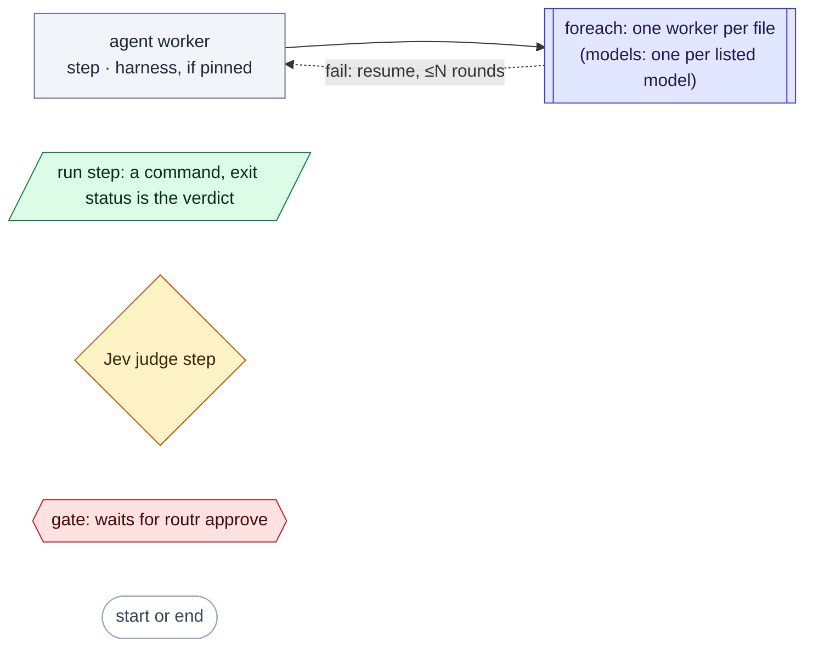

- A harness is named where the flow pins it. Elsewhere the role picks it;
  `review`, `hunt` and `refute` avoid the caller's harness. A `hunt` step
  lists candidates for later steps to verify and gives no verdict.
- Steps with no arrow between them run side by side, and a step waits for
  every arrow into it. An arrow into or out of a box of steps means every
  step in it.
- The charts leave out briefs, file names and caps (how many copies a
  fan-out makes, how many run at once); `routr flow show NAME --toml` has
  them.
- **Dashed edges** are `on_fail` loops: the failing step resumes the
  worker it points at with the failure, then runs again once that worker
  is done (what else runs again: flows.md, "Review loops"). At the round
  cap the failing step needs you (`routr approve` accepts its result).
- A run or judge step that fails with no `on_fail` is done, with verdict
  fail, and the steps after it wait for `routr approve`. As the last
  step, it ends the chain with that verdict.
- A Jev judge below its confidence floor (0.6), or without a key, needs
  you; `routr approve` takes its choice or asks again.

## plan-redteam

`--task '…'`. A one-shot plan (role `task`, since the `plan` role talks
with you), then codex at high effort red-teams it.

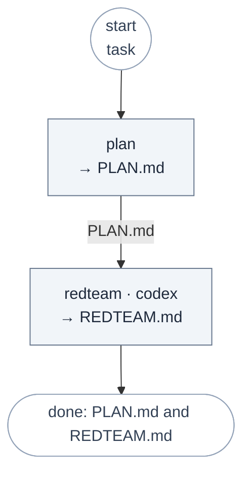

## plan-to-impl

`--task '…' --in DECISIONS.md`. You plan with a worker in its tab, a
reviewer on another harness red-teams the plan, and implementation waits
for you.

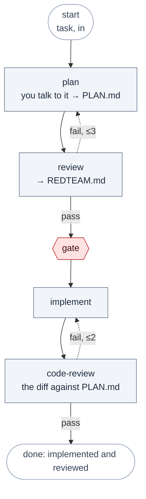

## research

`--in DIR`. You (or your agent) write one brief per file in DIR; a
researcher takes each, and one synthesis joins them.

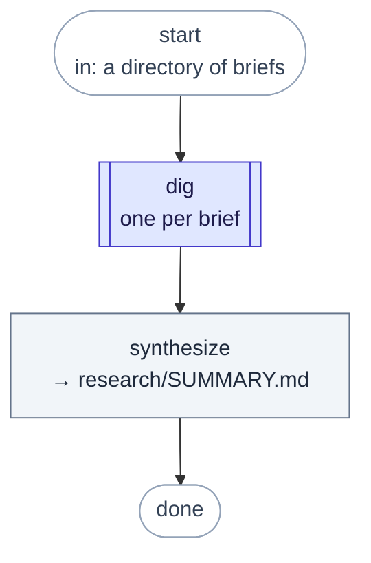

## adversarial-review

`--param target=main...HEAD` (or a file or a directory). Four lenses on
two vendors find problems; a cold refuter tries to disprove each one;
only what survives counts. REVIEW.md lists the confirmed problems, then
the rejected ones with reasons, and Jev decides whether it can ship as it
is.

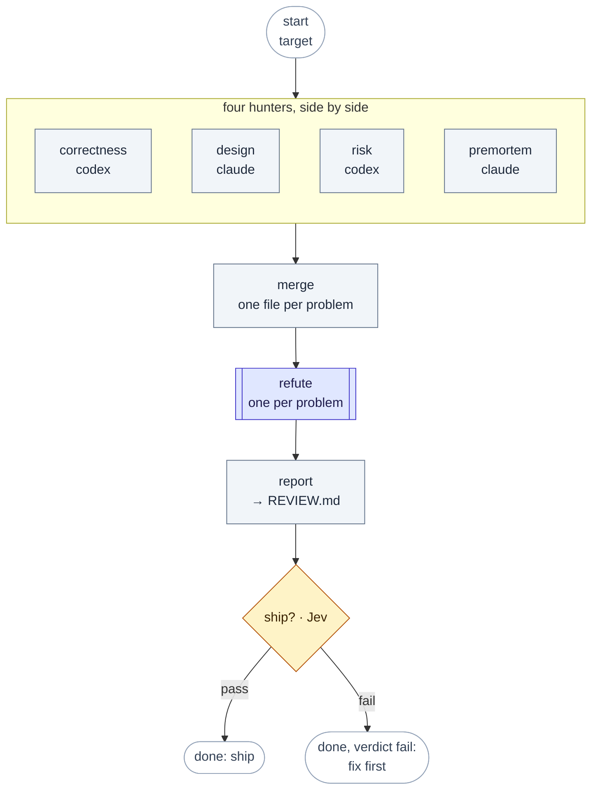

## security-review

`--param scope=DIR` (or files, or a git range). A threat model steers
three hunters: inject (untrusted data into sinks), access (authn, authz,
secrets) and robust (races, exhaustion, environment). A verifier per
candidate checks reachability, impact and existing defenses.

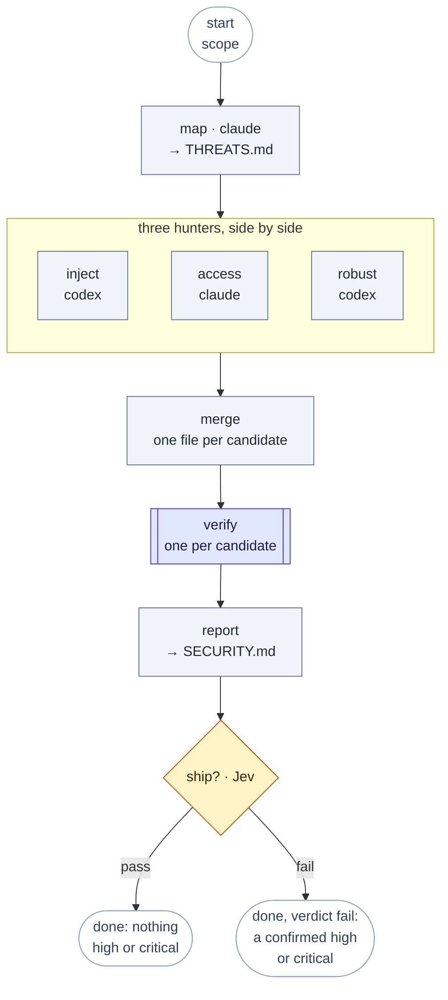

## deep-research

`--task 'the question'`. The flow splits the question itself, researches
the parts in parallel, and fact-checks its own synthesis. The researchers
look on the web unless the question names this repository or its files.
The fact-check does not trust the findings files: it opens the cited URL
or file:line of every claim the report rests on (at least five) and fails
if one of them is contradicted or could not be opened.

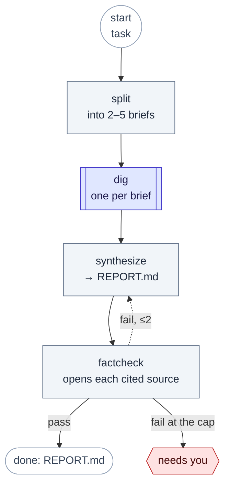

## fix-until-green

`--task '…' --param check='go test ./...'`. Tests decide when it is done,
then a reviewer checks that the implementer's claims are true. The
implementer may not weaken tests or commit.

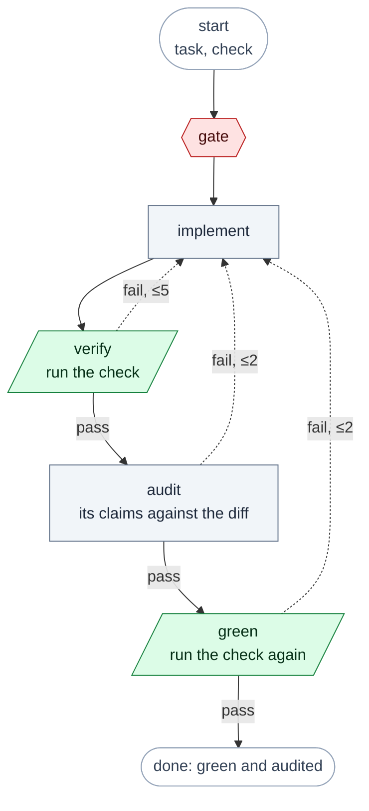

After an audit round the implementer revises, `verify` runs the check on
the revision, and the audit looks again. `green` runs the check once more
after the audit passes.

## repro-fix

`--param bug='…'`. A failing test is written first and becomes the spec;
the fixer may not change it, and hashes prove it didn't.

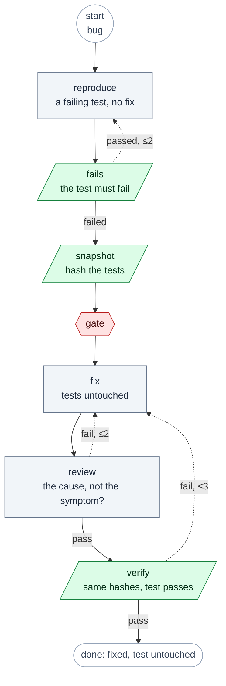

## debug-hypotheses

`--param bug='…'`. Competing explanations are tested in parallel, each by
a worker trying to prove it false; Jev picks the cause from the evidence.

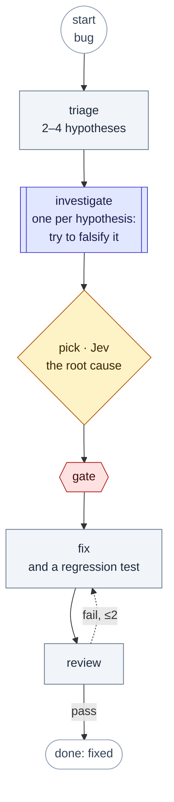

## best-of-n

`--task '…' --param check='…'`. Three harnesses attempt the same task,
each in its own git worktree; a check runs in each; Jev picks. About three
times the cost of one attempt, so only when asked.

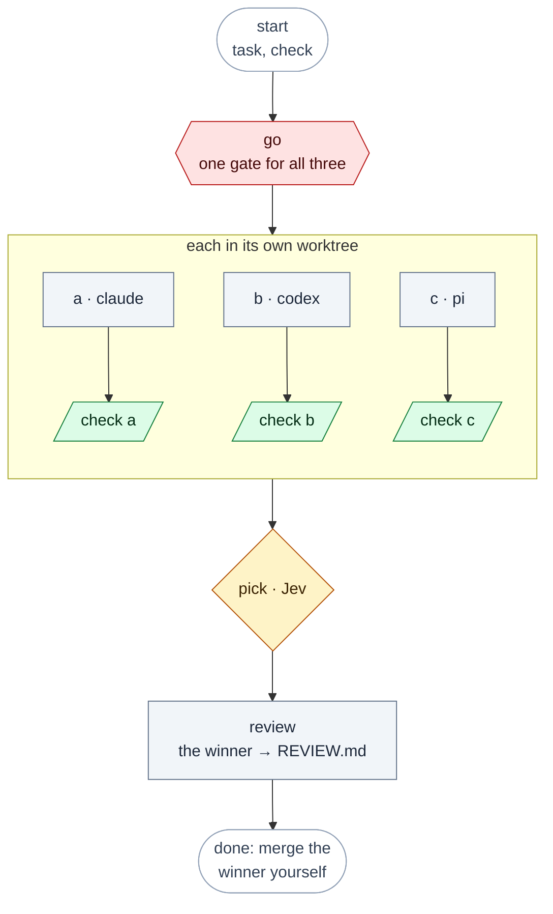

Each check runs in its attempt's worktree and takes that worktree's lock,
so the three run side by side. A check records its exit status and never
fails; Jev picks a green check first, then the smallest, clearest change,
and the review says how to merge the winner. Codex's sandbox can't write the main repo's
`.git`, so Codex can't commit in its worktree, and its attempt stays
uncommitted there.

## compare-models

`--task '…'`. Seven open-weight models — deepseek, glm, qwen, kimi,
mistral, minimax and seed, all over OpenRouter through pi — answer the same
prompt at once, each writing its own answer file; a claude reviewer ranks
them. The point is seeing how the models differ on a prompt you care
about, not the work itself: the copies are read-only (role `research`) and
write only into `{{work}}`.

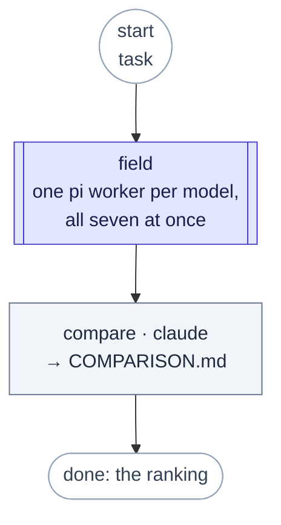

Pi resolves each `openrouter/...` id against its own providers, so the
list needs the ones it serves (and `OPENROUTER_API_KEY`). A copy that
names a model pi cannot serve fails its worker, loudly. The same shape
with `worktree = true` is a best-of-n over models; the models list is
yours to change: copy the flow into `.routr/flows/` and edit it
(`routr flow show compare-models --toml` prints it).
